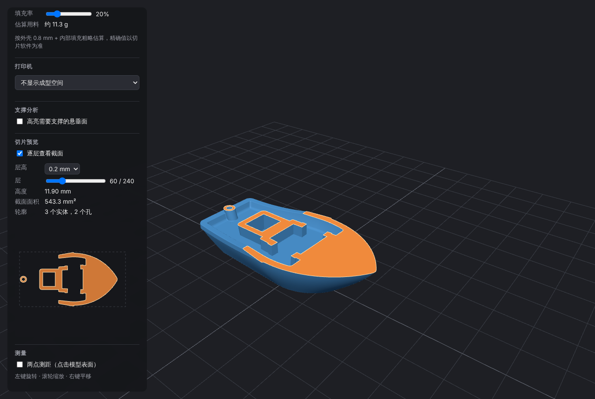

# STL / OBJ / 3MF Viewer

A browser-based 3D model viewer for 3D-printing files, built with **React + TypeScript + Three.js (WebGL)**.

**Live demo:** https://alicewwei.github.io/StlViewer/


## Features

- Load **STL** (binary and ASCII), **OBJ** and **3MF** files via file picker or drag-and-drop
- **Units**: 3MF's declared unit is applied automatically; STL/OBJ are assumed to be mm, with a hint when a model looks like it was exported in inches or metres
- Orbit / zoom / pan camera controls with damping
- Hemisphere + key/fill directional lighting, PBR material
- Converts CAD **Z-up** coordinates to Three.js **Y-up**, centres the model and places it on the build plate
- Auto-frames the camera to fit the model
- Shows triangle count and bounding-box dimensions, with an optional labelled bounding-box overlay
- **Print analysis**
  - Volume (signed tetrahedron method) and surface area
  - Material estimate in grams (PLA / PETG / ABS, adjustable infill)
  - Mesh health: open (hole) edges, non-manifold edges, degenerate triangles, watertight check
  - Printer build-volume check (Stratasys F170 / F370 and others), including "fits if rotated 90°"
  - Overhang highlighting in a custom shader with an adjustable support angle, plus total overhang area
- **Slice preview**: plane/triangle intersection, segments joined into closed contours, hole detection by nesting depth, filled cross-section in 3D (clipping plane + cap) and a 2D top view, with layer height and layer slider
- **Lay flat**: click a face to rotate it onto the build plate; overhang highlighting updates with the new orientation
- **Point-to-point measurement** via raycasting, reported in the file's own coordinate system (ΔX / ΔY / ΔZ)




## Architecture

```
src/
├── viewer/
│   ├── Viewer.ts      # Framework-agnostic Three.js viewer (scene, camera, lights, overhang shader, measuring, disposal)
│   ├── geometry.ts    # Pure geometry: volume, area, mesh check, overhang area, material estimate, printer fit
│   ├── slice.ts       # Slicing: plane intersection, contour joining, nesting, shoelace area
│   ├── units.ts       # Unit conversion and "is this really mm?" heuristic
│   ├── loadModel.ts   # STL / OBJ / 3MF parsing (3MF unit read from the model XML)
│   ├── *.test.ts      # Vitest unit tests
├── components/
│   └── ViewerCanvas.tsx  # Thin React wrapper: mounts/disposes the Viewer, pushes new geometry
└── App.tsx            # UI: file input, drag-and-drop, model info panel
electron/
├── main.cjs           # Electron main process: window, native menu, file reading, single instance
└── preload.cjs        # contextBridge API exposed to the page as window.desktop
```

The rendering code lives in a plain TypeScript class rather than inside React components. React only owns the lifecycle (create on mount, `dispose()` on unmount), which keeps the 3D logic unit-testable and portable (e.g. to an Electron shell). GPU resources (geometries, materials, the WebGL context) are released explicitly, since JavaScript garbage collection does not free GPU memory.

## Getting started

```bash
npm install
npm run dev      # http://localhost:5173
npm test         # unit tests (Vitest)
npm run e2e      # end-to-end tests (Playwright; builds and serves the app itself)
npm run build    # production build in dist/
```

Sample models (3DBenchy, gear, teapot, vase, box, an L bracket in 3MF and a gear exported in inches) are in `public/samples/` and can be opened from the dropdown in the app. See `public/samples/README.md` for sources and licenses.

## Desktop app (Electron)

The same React app also runs as a Windows desktop app. The Electron part is small and lives in `electron/`:

- `electron/main.cjs`: creates the window (`contextIsolation` on, `nodeIntegration` off, `sandbox` on) and the native menu, **File › Open… (Ctrl+O)** and **File › Exit**. Menu labels follow the app language. It reads the chosen file and sends its bytes to the page.
- `electron/preload.cjs`: exposes a minimal `window.desktop` API (`openFileDialog`, `onOpenFile`, `setLanguage`) through `contextBridge`. The page wraps the bytes in a `File` and reuses the normal `parseModel` path. The web build has no `window.desktop`, so it is unaffected.
- **File associations**: the installer registers `.stl`, `.obj` and `.3mf`. Double-clicking a model, or passing a path on the command line, opens it. If the app is already running, the file opens in the existing window (single-instance lock).

```bash
npm run electron:dev     # Vite dev server + Electron with hot reload
npm run electron:dev -- public/samples/box.stl   # open a file on start
npm run electron:build   # Windows installer in release/ (NSIS, x64)
```

`electron:build` builds the page with a relative base (`vite build --base ./`) so it loads from `file://`. The GitHub Pages build keeps its `/StlViewer/` base. The installer is unsigned and uses the default Electron icon.

## Testing

| Layer | Tool | What it covers |
|-------|------|----------------|
| Unit | Vitest (`src/**/*.test.ts`) | Pure geometry: volume, area, mesh check, overhangs, slicing, units, i18n dictionary |
| End-to-end | Playwright (`e2e/*.e2e.ts`) | Real browser: sample loading, file picker, drag-and-drop, rotate/zoom, language switch, error messages, 3MF units, inch conversion, overhangs, slicing, measuring, and a reference screenshot of the WebGL canvas |
| Desktop | Playwright `_electron` (`e2e/electron/*.e2e.ts`, `npm run e2e:electron`) | The packaged Electron app: opening a file from the command line (file association), page isolation from Node.js, File › Open with a stubbed native dialog, cancel, and menu language |

Every test also fails if the page logs a JavaScript error. Both suites run on every pull request, and the GitHub Pages deployment only happens when they pass. WebGL runs on SwiftShader (software rendering) in CI, so no GPU is needed.

## Roadmap

- [x] Measurement tool (point-to-point distance)
- [x] Bounding box overlay
- [x] Volume calculation (signed tetrahedron method) and print-material estimate
- [x] Overhang / support analysis
- [x] Unit tests (Vitest) for geometry utilities
- [x] Slice preview (cross-section at a given Z height)
- [x] Lay a selected face flat on the build plate
- [x] mm / inch unit switch
- [x] 3MF support
- [x] Electron desktop packaging
- [x] End-to-end tests (Playwright) in CI

## Tech stack

React 19 · TypeScript · Vite · Three.js / GLSL · Vitest · GitHub Actions / Pages
