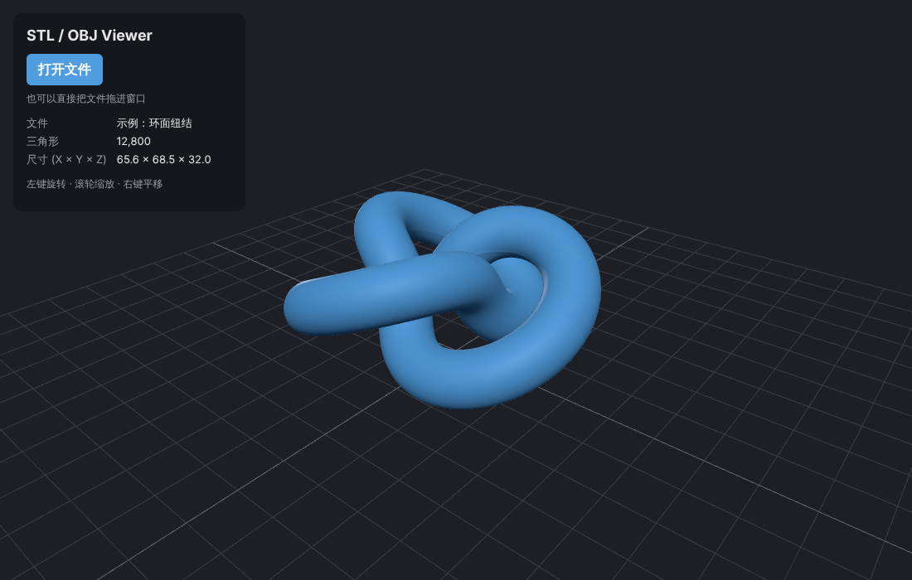
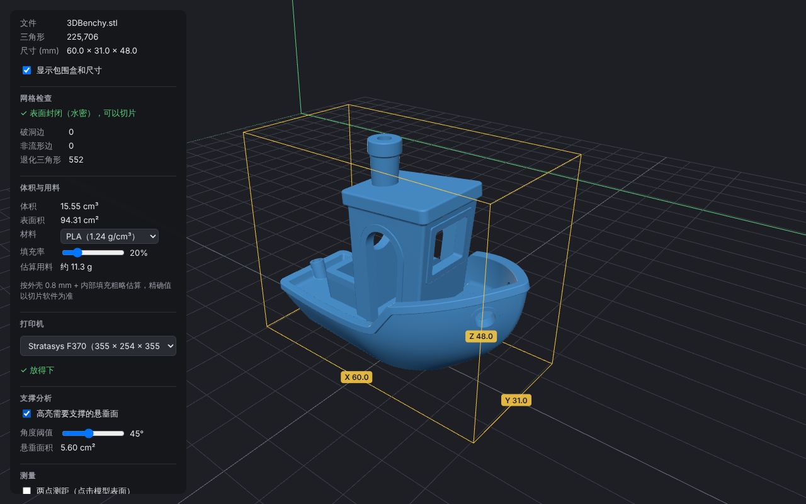

# STL / OBJ Viewer

A browser-based 3D model viewer for 3D-printing files, built with **React + TypeScript + Three.js (WebGL)**.

**Live demo:** https://alicewwei.github.io/StlViewer/



## Features

- Load **STL** (binary and ASCII) and **OBJ** files via file picker or drag-and-drop
- Orbit / zoom / pan camera controls with damping
- Hemisphere + key/fill directional lighting, PBR material
- Converts CAD **Z-up** coordinates to Three.js **Y-up**, centres the model and places it on the build plate
- Auto-frames the camera to fit the model
- Shows triangle count and bounding-box dimensions, with an optional labelled bounding-box overlay
- **Print analysis**
  - Volume (signed tetrahedron method) and surface area
  - Material estimate in grams (PLA / PETG / ABS, adjustable infill)
  - Mesh health: open (hole) edges, non-manifold edges, degenerate triangles, watertight check
  - Printer build-volume check (Stratasys F170 / F370 and others), including "fits if rotated 90°"
  - Overhang highlighting in a custom shader with an adjustable support angle, plus total overhang area
- **Point-to-point measurement** via raycasting, reported in the file's own coordinate system (ΔX / ΔY / ΔZ)



## Architecture

```
src/
├── viewer/
│   ├── Viewer.ts      # Framework-agnostic Three.js viewer (scene, camera, lights, overhang shader, measuring, disposal)
│   ├── geometry.ts    # Pure geometry: volume, area, mesh check, overhang area, material estimate, printer fit
│   ├── geometry.test.ts  # Vitest unit tests
│   └── loadModel.ts   # File → BufferGeometry parsing (STL / OBJ, OBJ meshes merged)
├── components/
│   └── ViewerCanvas.tsx  # Thin React wrapper: mounts/disposes the Viewer, pushes new geometry
└── App.tsx            # UI: file input, drag-and-drop, model info panel
```

The rendering code lives in a plain TypeScript class rather than inside React components. React only owns the lifecycle (create on mount, `dispose()` on unmount), which keeps the 3D logic unit-testable and portable (e.g. to an Electron shell). GPU resources (geometries, materials, the WebGL context) are released explicitly, since JavaScript garbage collection does not free GPU memory.

## Getting started

```bash
npm install
npm run dev      # http://localhost:5173
npm test         # unit tests (Vitest)
npm run build    # production build in dist/
```

Sample models (3DBenchy, gear, teapot, vase, box) are in `public/samples/` and can be opened from the dropdown in the app. See `public/samples/README.md` for sources and licenses.

## Roadmap

- [x] Measurement tool (point-to-point distance)
- [x] Bounding box overlay
- [x] Volume calculation (signed tetrahedron method) and print-material estimate
- [x] Overhang / support analysis
- [x] Unit tests (Vitest) for geometry utilities
- [ ] Slice preview (cross-section at a given Z height)
- [ ] Lay a selected face flat on the build plate
- [ ] mm / inch unit switch
- [ ] Electron desktop packaging

## Tech stack

React 19 · TypeScript · Vite · Three.js / GLSL · Vitest · GitHub Actions / Pages
